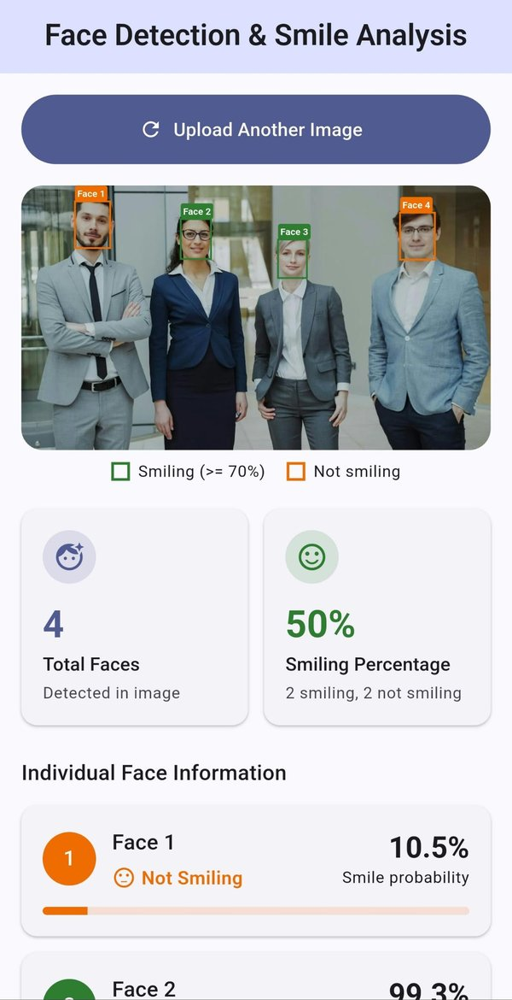
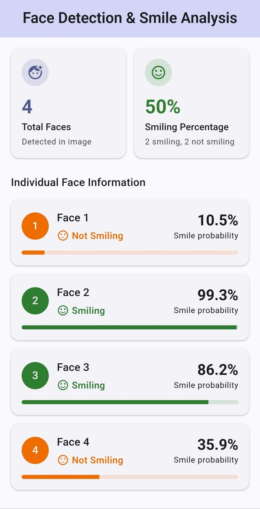
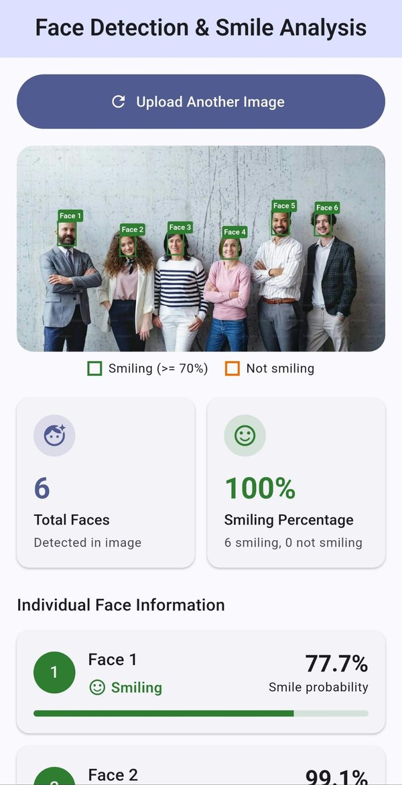
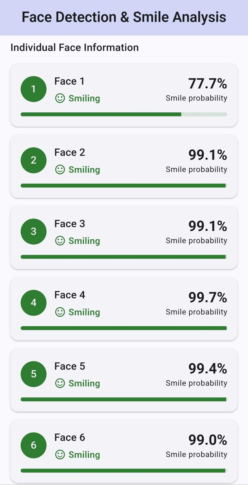
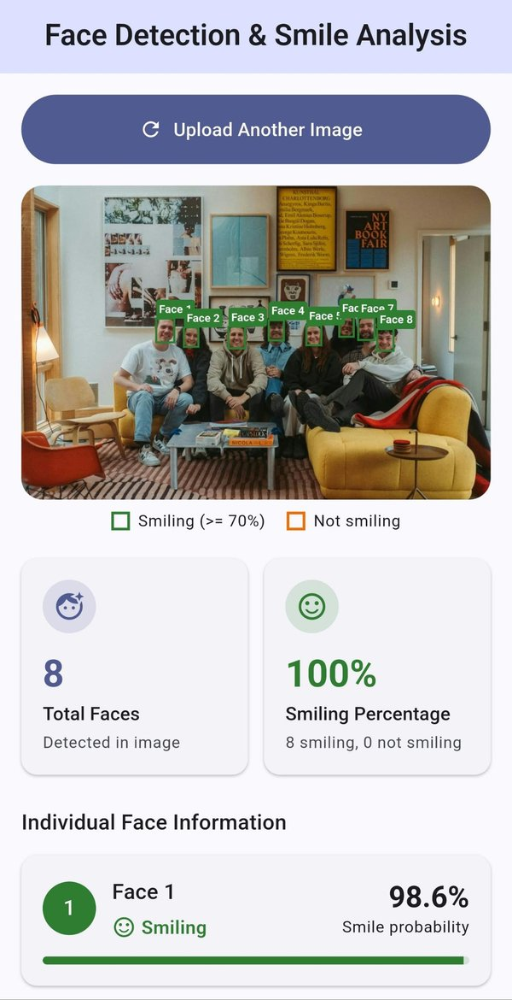
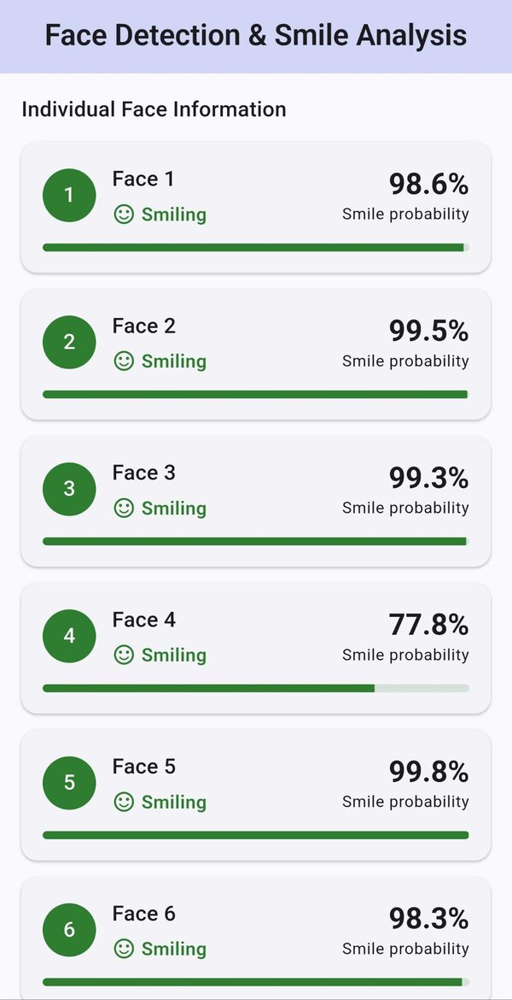
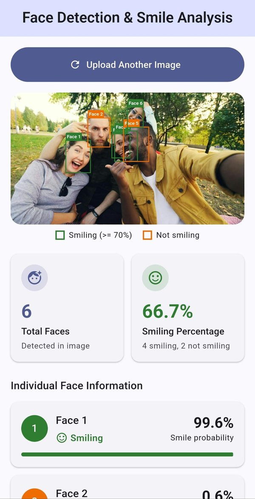
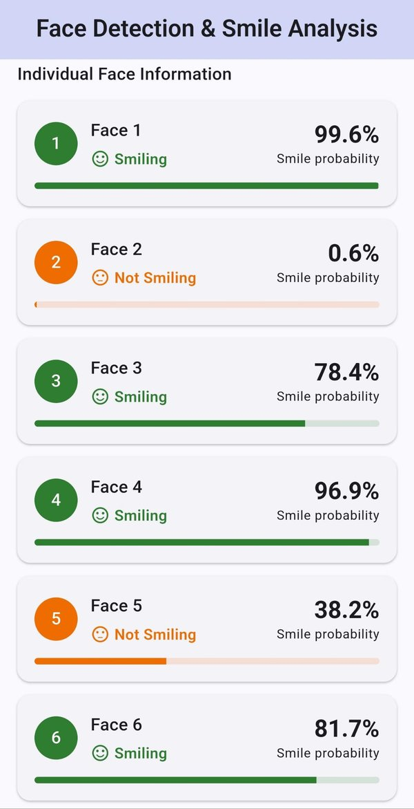

<div align="center">

# Face Detection & Smile Analysis

**An on-device Flutter app that detects every face in a photo and measures how many of them are smiling, using Google ML Kit.**


</div>

---

## Overview

Face Detection & Smile Analysis lets a user pick an image from the device gallery and analyses it instantly. The app finds all faces in the image, draws a labelled bounding box around each one, and summarises the result in analytics cards: the total number of faces, the percentage of smiling faces, and a detailed card for every individual face.

All processing runs **on the device** with Google ML Kit. No image is uploaded to a server, so analysis is fast, works offline, and keeps photos private.

## App in Action

The app was tested on a real Android device with group photos of different sizes and expressions. In every image, each detected face is boxed and labelled, green for smiling and orange for not smiling, and the analytics cards update automatically.

### Mixed Expressions: 4 faces, 50% smiling

Two people smile and two keep a neutral expression, so the app reports 2 smiling and 2 not smiling.

<table>
  <tr>
    <td align="center"></td>
    <td align="center"></td>
  </tr>
  <tr>
    <td align="center"><sub>Face detection and analytics</sub></td>
    <td align="center"><sub>Individual face information</sub></td>
  </tr>
</table>

### All Smiling: 6 faces, 100% smiling

Every face scores above the 70% threshold, so the smiling percentage reaches 100%.

<table>
  <tr>
    <td align="center"></td>
    <td align="center"></td>
  </tr>
  <tr>
    <td align="center"><sub>Face detection and analytics</sub></td>
    <td align="center"><sub>Individual face information</sub></td>
  </tr>
</table>

### Large Group: 8 small faces detected

All eight faces are found even though each one takes up only a small part of a wide indoor photo.

<table>
  <tr>
    <td align="center"></td>
    <td align="center"></td>
  </tr>
  <tr>
    <td align="center"><sub>Face detection and analytics</sub></td>
    <td align="center"><sub>Individual face information</sub></td>
  </tr>
</table>

### Close-up Group Selfie: overlapping faces

A close-up selfie with tilted heads and overlapping faces. The app still separates smiling faces from non-smiling ones.

<table>
  <tr>
    <td align="center"></td>
    <td align="center"></td>
  </tr>
  <tr>
    <td align="center"><sub>Face detection and analytics</sub></td>
    <td align="center"><sub>Individual face information</sub></td>
  </tr>
</table>

<sub>The test images are free stock photos, used only to demonstrate the app.</sub>

## Features

| Feature | Description |
| --- | --- |
| Image upload | Pick a photo from the gallery, preview it, and upload another image at any time |
| Multi-face detection | Detects every face in a single image with Google ML Kit Face Detection |
| Bounding boxes | Draws a rectangle and a `Face N` label over each detected face, scaled precisely to the displayed image |
| Total Faces card | Shows the number of detected faces and updates automatically after each analysis |
| Smiling Percentage card | Shows the share of smiling faces along with a smiling / not-smiling breakdown |
| Individual face cards | Face number, smile status and smile probability for every face |
| Colour coding | Green marks smiling faces and orange marks non-smiling faces, both on the image and in the cards |

## How Smile Analysis Works

ML Kit's classification mode returns a **smile probability** between `0.0` and `1.0` for every detected face.

- A face is classified as **Smiling** when its smile probability is **greater than or equal to 0.7 (70%)**.
- The smiling percentage is calculated as:

```
Smiling Percentage = (Number of Smiling Faces / Total Detected Faces) × 100
```

- If no face is detected, the smiling percentage is **0%**.

**Example:** 4 faces detected, 3 smiling and 1 not smiling, gives a smiling percentage of **75%**.

Faces are numbered from left to right, so `Face 1` is always the left-most face in the image.

## Tech Stack

| Layer | Technology |
| --- | --- |
| Framework | [Flutter](https://flutter.dev) (Material 3) |
| Language | [Dart](https://dart.dev) |
| Face detection | [`google_mlkit_face_detection`](https://pub.dev/packages/google_mlkit_face_detection), with classification enabled and accurate performance mode |
| Image selection | [`image_picker`](https://pub.dev/packages/image_picker) |
| State management | [`provider`](https://pub.dev/packages/provider) (`ChangeNotifier`) |
| Rendering | `CustomPainter` for the bounding-box overlay |
| Testing | `flutter_test` unit tests for the smile calculations |

## Architecture

The app follows a simple layered structure that keeps detection logic separate from the UI:

```
User picks image
      │
      ▼
FaceAnalysisProvider ──► image_picker (gallery)
      │
      ├──► Reads image dimensions
      ├──► ML Kit FaceDetector.processImage()
      │
      ▼
List<FaceResult> + AnalysisSummary
      │
      ▼
HomeScreen rebuilds ──► ImagePreview + FaceBoxPainter
                    ──► StatCard (Total Faces, Smiling %)
                    ──► FaceInfoCard (one per face)
```

### Project Structure

```
lib/
├── main.dart                              # App entry point, theme and Provider setup
├── models/
│   └── face_result.dart                   # FaceResult, AnalysisSummary, 70% threshold, percentage formula
├── providers/
│   └── face_analysis_provider.dart        # Image picking, ML Kit detection and app state
├── screens/
│   └── home_screen.dart                   # Main screen layout
└── widgets/
    ├── image_preview.dart                 # Image preview with the detection overlay
    ├── face_box_painter.dart              # Draws bounding boxes and face labels
    ├── stat_card.dart                     # Total Faces and Smiling Percentage cards
    └── face_info_card.dart                # Individual face information card
test/
└── widget_test.dart                       # Unit tests for the smile analysis logic
```

### Bounding-Box Accuracy

ML Kit returns face coordinates in the original image's pixel space. The preview lays out the image and the `CustomPainter` at the image's real resolution and lets a `FittedBox` scale both together. This keeps every box aligned with its face on any screen size or image aspect ratio.

## Getting Started

### Prerequisites

- Flutter SDK (Dart 3.8 or later)
- Android Studio or VS Code with the Flutter extension
- An Android device or emulator

### Installation

```bash
# Clone the repository
git clone https://github.com/ssheikhs/face-detection-smile-analysis.git
cd face-detection-smile-analysis

# Install dependencies
flutter pub get

# Run the app
flutter run
```

### Running Tests

```bash
flutter test
```

The tests cover the smiling-percentage formula, the 70% threshold boundary, the no-face case, and faces without a smile probability.

## Usage

1. Open the app and tap **Upload Image**.
2. Choose a photo containing one or more faces from your gallery.
3. The app analyses the image automatically and draws a box around each face.
4. Review the **Total Faces** and **Smiling Percentage** cards.
5. Scroll to **Individual Face Information** for each face's details.
6. Tap **Upload Another Image** to analyse a new photo.

For the best results, use clear, well-lit photos where faces are facing the camera.

## Author

**Sheikh Sazzaduzzaman**

- GitHub: [@ssheikhs](https://github.com/ssheikhs)

---

<div align="center">
Built as part of the Ostad Flutter course, Module 31: On-device Machine Learning with Flutter.
</div>
